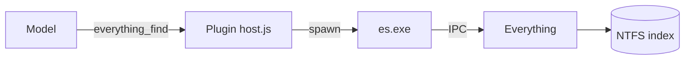

<div align="center">

# dsh-everything-find

**Everything's Windows file index, exposed as a model-callable search tool**

No directory guessing, no shell — one `everything_find` call locates a file anywhere on disk.

[](https://www.npmjs.com/package/dsh-everything-find)
[](https://github.com/oldHan2423/dsh-everything-find/blob/main/LICENSE)
[](https://github.com/oldHan2423/dsh-everything-find/stargazers)
[](https://www.voidtools.com/)
[](https://github.com/deepseek-ai/deepseek-harness)

[Why](#why-a-file-search-tool) · [How it works](#how-it-works) · [Quick start](#quick-start) · [Tool](#tool-everything_find) · [Configuration](#configuration) · [Fallback](#availability-and-fallback) · [Troubleshooting](#troubleshooting) · [Limits](#requirements-and-known-limitations)

[中文](README.md) | English

</div>

It talks to the running Everything through the official command-line interface **ES** (`es.exe`) over IPC: **it changes no Everything setting and needs no HTTP server**. The plugin ships `es.exe`, so it works right after install.

## Why a file search tool

`glob` / `grep` walk path patterns recursively: fast inside a folder you already know, slow when the name is all you remember and the file could be on any volume. Everything matches names against its NTFS index instead, answers a whole-disk query in milliseconds, and filters by size, modification time, and file type.

| What you are looking for | Which tool |
|---|---|
| Only a fragment of the file name, e.g. `*.spec.ts` | `everything_find` |
| A folder you know, and what is inside it | `everything_find` + `path` (add `directOnly` for direct children) |
| Files by size, modification time, or type | `everything_find`: `size:>1mb`, `dm:today`, `ext:ts` |
| A string inside file contents | `grep` — Everything builds no content index |
| Non-Windows, or Everything is not running | The built-in `glob` / `grep` — a failed probe leaves the tool unregistered, so lookup falls back automatically |

## How it works



1. `es.exe` is resolved by the order below.
2. Each call spawns `es.exe` once and exports the rows to a temporary JSON file, then reads that file back: `es.exe` prints its console output in the ANSI code page (mojibake for non-ASCII paths), while the export is UTF-8.
3. `-name -path-column -size -dm` make the export carry name, path, size, and modification time directly; a page that filled `max` asks once more with `-get-result-count` for the real match total.

## Quick start

Two prerequisites only: **Windows**, and **Everything running** with the volumes you search already indexed.

### Install

```powershell
# From npm (published, recommended)
dsh plugin --profile web add dsh-everything-find

# Or straight from GitHub
dsh plugin --profile web add github:oldHan2423/dsh-everything-find

# `pnpm dsh …` when running dsh from source; plain `dsh …` for a global install
```

`dsh plugin` forwards its arguments to pnpm **inside the profile directory**, so `file:`, local-directory, git, and tarball specs work the same way. Restart when it tells you to.

Manual install: drop this package into the profile's `node_modules` and add it to the profile `package.json` under both `dependencies` and `dsh.profile.bundles`.

> **The manifest must be UTF-8 without a BOM**: startup parses every bundle's `package.json` with `JSON.parse`, so a BOM stops the instance from booting.

A `file:` install is linked into the profile at install time. Editing the source afterwards does not reach the running profile: re-run `dsh plugin … add` (or copy the changed files into `node_modules/dsh-everything-find`) and reload.

### First call

Ask the model where the `.spec.ts` files on drive D are, and it calls:

```json
// arguments
{ "query": "*.spec.ts", "type": "files", "max": 20 }
```

```json
// result
{
  "count": 1,
  "total": 1,
  "truncated": false,
  "results": [
    { "name": "a.spec.ts", "path": "D:\\repo\\tests", "size": 1234, "dateModified": "2026-09-11T15:19:18" }
  ]
}
```

## Tool: `everything_find`

| Parameter | Required | Meaning |
|---|---|---|
| `query` | conditional | Everything search syntax: space = AND, `\|` = OR, `!` = NOT; supports `ext:ts`, `dm:today`, `size:>1mb`, `path:foo`; `*` matches every name |
| `path` | conditional | Restrict to a folder and **all of its subfolders**; `path` alone lists that whole tree |
| `directOnly` | | List only the **direct children** of `path`, without recursing (requires `path`; es.exe `-parent`) |
| `max` | | Result cap; defaults to the configured `maxResults` (50) and is clamped to 1000 |
| `type` | | `any` / `files` / `folders` |
| `sort` | | One of `name`, `path`, `size`, `extension`, `date-created`, `date-modified`, `date-accessed`, `attributes`, `filelist-filename`, `run-count`, `date-recently-changed`, `date-run` |
| `descending` | | Sort descending |

At least one of `query` or `path` is required: with neither, the call is refused (Everything would otherwise return the head of the whole index); `path` alone behaves like `query: "*"` plus `path`.

`count` is the size of this page, `total` the number of matches Everything reports, and `truncated` means the page is shorter than the match set: a page that filled `max` asks Everything for the real total, while a short page already **is** the whole set. Raise `max` (up to 1000) or narrow `query`/`path` to see the rest.

## Configuration

On DSH 0.1.7 and later: **Settings → Plugins → `dsh-everything-find`**. The card sits on the bundle's own page, under its description, and renders with the same components as the built-in settings pages.

| Setting | Default | Meaning |
|---|---|---|
| `esExe` | empty | Absolute path to `es.exe`; empty auto-detects (see the order below) |
| `esInstance` | empty | Everything instance name to query (`es.exe -instance`); empty means the unnamed instance a normal installation runs |
| `timeoutMs` | `10000` | Milliseconds `es.exe` waits for the Everything database to finish loading before it sends the query (`es.exe -timeout`). Raise it on a large index or a slow disk |
| `maxResults` | `50` | Default result cap when a call omits `max` (a single call may ask for at most 1000) |

The `es.exe path` control **shows the path in effect** while nothing overrides it, and the line under it names its origin (the configured path, the bundled copy, the system `PATH`, or a common install location); the card detects once as soon as it opens. **Leaving the control untouched overrides nothing**: automatic detection stays in force and no path is written to the configuration. Typing a path or picking one with Browse turns it into a pinned override — the field then shows the overridden badge, and Reset restores the automatic behavior. `Everything instance` has nothing to detect, so an empty value is the default unnamed instance.

Beside the path field:

- **重新检测 (re-detect)** — run the detection again, e.g. after changing `PATH` or installing ES.
- **浏览… (browse)** — open the host's directory chooser and pick the directory holding es.exe (usually `C:\Program Files\Everything`); the plugin locates that directory's `es.exe` and stages it in the path field. **The staged path still needs Save.**

Browse uses DSH's official directory-picker capability (the native OS chooser on a local deployment); a deployment that offers only the in-app browse backend shows no Browse button, and the path field remains the way to set it.

### Resolution order

`es.exe` is resolved in this order (first hit wins):

1. `esExe` from the configuration card
2. `config.esExe` in `cordis.yml` / the plugin patch
3. **The bundled `bin/es.exe`** — the default, works right after install
4. The system `PATH`
5. Common install locations (`C:\Program Files\Everything\es.exe`, Scoop, Chocolatey, …)

Saving takes effect on the next call: the fields are `volatile`, so an accepted edit applies in place without remounting the plugin, and no restart is needed.

### Override with a patch

On a deployment whose settings surface serves no configuration form, override the entry the bundle's patch inserts in the profile's `cordis.patch.yml` instead:

```yaml
- id: dsh-everything-find
  config:
    esExe: 'C:\Program Files\Everything\es.exe'
    timeoutMs: 20000
    maxResults: 100
```

### DSH version compatibility

The configuration card renders with the built-in settings pages' own components (`SettingsForm` + `SettingsValueField`) and needs DSH **0.1.7 or later**: it uses the `configForms` service and the Plugins page's `plugins.bundle.config` slot, and declares its fields `volatile`, so an accepted edit applies without remounting the plugin. Earlier releases have no such settings surface: the plugin still provides `everything_find`, but its configuration lives in the profile's `cordis.patch.yml` and no card appears.

## Availability and fallback

The plugin probes once asynchronously after load (using the configured `timeoutMs`) and decides whether to expose `everything_find`:

- **Probe passes** → the tool is registered; its description steers the model to **reach for it first when locating files or folders**, keeping grep for file contents.
- **Unavailable** (`es.exe` cannot be resolved, or ES exits 8 = Everything's IPC window is absent) → **the tool is not registered**, so file lookup falls back to the built-in glob / grep tools. Start Everything, then reload the plugin or restart DSH to get it back.
- **Any other error** (including a failed probe) → the tool stays registered (fail-open); the real problem surfaces on the call and tells the model to use the built-in glob tool instead.

## Troubleshooting

| Symptom | Cause | Fix |
|---|---|---|
| The model never reaches for `everything_find` | The probe failed: `es.exe` cannot be resolved, or Everything is not running | Start Everything and press re-detect on the card; or reload the plugin / restart DSH |
| `Everything is not running (its IPC window was not found)` | ES exited 8: Everything's IPC window is absent | Start Everything (a tray-resident instance is enough) |
| `es.exe was not found at: <path>` | The configured `esExe` points at a file that does not exist | Press Reset on the card to return to auto-detection, or fix the path |
| `Error 6: Unknown switch` | The ES behind `esExe` predates 1.1.0.3x | Fall back to the bundled `bin/es.exe` (1.1.0.38), or upgrade ES |
| A file that exists is not found | Its volume is not indexed, or the index is stale | Add the volume in Everything / rebuild the index; try `type: any` first to rule out the type filter |
| The result says `truncated: true` | More matches than `max` | Raise `max` (up to 1000) or narrow `query` / `path` |
| A configuration edit does nothing | Save was not pressed; or DSH predates 0.1.7, which has no card | Press Save; on older releases edit the profile's `cordis.patch.yml` |
| A multi-instance install queries the wrong instance | An empty `esInstance` means the unnamed instance | Fill in the instance name to query |

## Requirements and known limitations

- **Windows only** — Everything is a Windows tool.
- **Everything must be running** — `es.exe` reaches it over IPC; when it is not, see the fallback section above (the tool is not registered).
- **ES 1.1.0.3x or newer** — every query ends with the `--` switch terminator, which ES 1.1.0.27 rejects with `Error 6: Unknown switch`; the bundled copy is 1.1.0.38. Point `esExe` at an older ES and every call fails.
- **Name and path matches only** — file contents are not searched (Everything has no content index here); use the grep tool for content search (the tool description says so too).
- **Indexed volumes only** — whatever Everything indexes is what can be found.
- **A single page holds at most 1000 rows** — narrow the query rather than raising `max` further.

## Development

### No build step

The host half is plain ESM (`host.js`) and the browser half is a hand-written lazy-CJS factory (`client.js`): no TypeScript, no bundler — edit, resync, restart; no `pnpm build`.

| File | Role |
|---|---|
| `host.js` | Host half: the `everything_find` tool, the configuration schema, `es.exe` detection and queries |
| `client.js` | Browser half: the configuration card on the Plugins page |
| `cordis.patch.yml` | Bundle patch: inserts this plugin's entry into a profile |
| `bin/es.exe` | The bundled ES 1.1.0.38 |
| `test/smoke.mjs` | Self-test for both halves, no test runner needed |

### Self-test

`test/smoke.mjs` drives both halves without a test runner. Run it from the installed copy, because the DSH packages it imports resolve through the profile:

```powershell
node <profile>\node_modules\dsh-everything-find\test\smoke.mjs
```

It checks the tool schema, the argument handling, the result contract against the real `es.exe`, and the card's registration and write path; the `es.exe` cases self-skip when Everything is not running.

## License and third party

- This plugin: MIT
- The bundled `bin/es.exe` comes from [voidtools/ES](https://github.com/voidtools/ES) (MIT, Copyright (c) 2025 voidtools); full text in `LICENSE-ES.txt`

## Star history

[](https://star-history.com/#oldHan2423/dsh-everything-find&Date)

<div align="center">

[](https://github.com/deepseek-ai/deepseek-harness)

</div>
